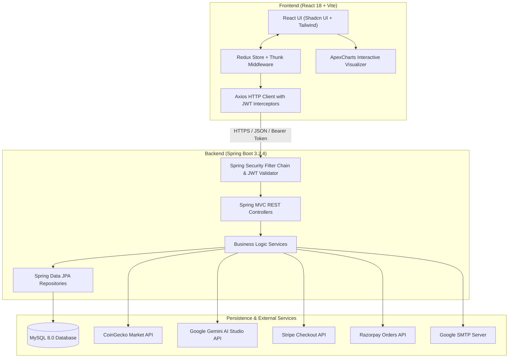
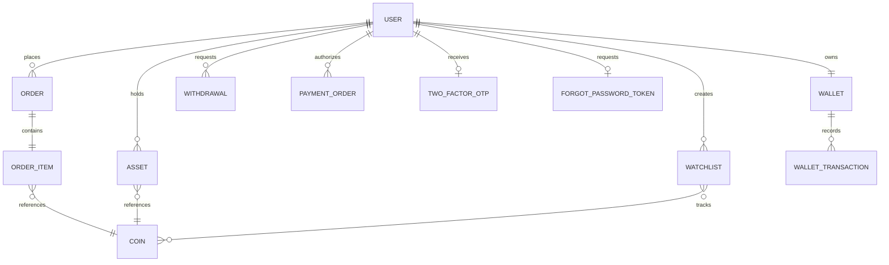

# 📖 Crypto Trading Platform - Technical Documentation

Welcome to the comprehensive technical documentation for the **Crypto Trading Platform**. This document provides in-depth architectural specifications, entity relationship designs, complete REST API definitions, security implementations, external integration workflows, and production deployment guidelines.

---

## 📑 Table of Contents

1. [System Architecture](#1-system-architecture)
2. [Database Schema & Entity Models](#2-database-schema--entity-models)
3. [Complete REST API Reference](#3-complete-rest-api-reference)
   - [Authentication & 2FA (`/auth`)](#31-authentication--2fa-auth)
   - [User Management (`/api/users`)](#32-user-management-apiusers)
   - [Market Data & Coins (`/coins`)](#33-market-data--coins-coins)
   - [Trading & Orders (`/api/orders`)](#34-trading--orders-apiorders)
   - [Asset & Portfolio Management (`/api/assets`)](#35-asset--portfolio-management-apiassets)
   - [Wallet & Transactions (`/api/wallet`)](#36-wallet--transactions-apiwallet)
   - [Payment Processing (`/api/payment`)](#37-payment-processing-apipayment)
   - [Withdrawals & Banking (`/api/withdrawal`)](#38-withdrawals--banking-apiwithdrawal)
   - [Watchlist (`/api/watchlist`)](#39-watchlist-apiwatchlist)
   - [AI Crypto Assistant (`/chat`)](#310-ai-crypto-assistant-chat)
4. [Authentication & Security Architecture](#4-authentication--security-architecture)
5. [External Service Integrations](#5-external-service-integrations)
   - [Google Gemini AI](#51-google-gemini-ai)
   - [CoinGecko API](#52-coingecko-api)
   - [Stripe & Razorpay Gateways](#53-stripe--razorpay-gateways)
   - [SMTP Email Service](#54-smtp-email-service)
6. [Frontend State Management & Redux Architecture](#6-frontend-state-management--redux-architecture)
7. [Local Setup & Environment Configuration](#7-local-setup--environment-configuration)
8. [Production Deployment Guidelines](#8-production-deployment-guidelines)
9. [Troubleshooting & FAQs](#9-troubleshooting--faqs)

---

## 1. System Architecture

The platform follows a clean, decoupled, layered client-server architecture:



### Component Breakdown
- **Presentation Layer**: React 18, React-Router v6 for routing, Redux for centralized state management, Tailwind CSS for modern aesthetic styling, and ApexCharts for live financial market charts.
- **API Gateway & Security Layer**: Spring Security 6, custom `JwtTokenValidator` filter intercepting inbound requests, stateless session management, and fine-grained CORS filters.
- **Service Layer**: Decoupled service interfaces (`UserService`, `WalletService`, `OrderService`, `CoinService`, `PaymentService`, `ChatBotService`) encapsulating transactional business logic.
- **Persistence Layer**: Spring Data JPA using Hibernate as the JPA provider, mapped directly to MySQL relational tables.

---

## 2. Database Schema & Entity Models



### Key Entities

#### `User`
- `id`: Long (Primary Key)
- `fullName`: String
- `email`: String (Unique index)
- `password`: String (BCrypt hashed)
- `role`: `USER_ROLE` (`ROLE_CUSTOMER`, `ROLE_ADMIN`)
- `isTwoFactorAuthEnabled`: Boolean
- `twoFactorAuth`: Embedded 2FA configuration

#### `Wallet`
- `id`: Long (Primary Key)
- `user`: OneToOne reference to `User`
- `balance`: BigDecimal (High-precision balance tracking)

#### `WalletTransaction`
- `id`: Long (Primary Key)
- `wallet`: ManyToOne reference to `Wallet`
- `type`: `WalletTransactionType` (`WITHDRAWAL`, `WALLET_TRANSFER`, `ADD_MONEY`, `BUY_ASSET`, `SELL_ASSET`)
- `date`: LocalDate
- `transferId`: String
- `purpose`: String
- `amount`: Long / BigDecimal

#### `Order`
- `id`: Long (Primary Key)
- `user`: ManyToOne reference to `User`
- `orderType`: `OrderType` (`BUY`, `SELL`)
- `price`: BigDecimal
- `timestamp`: LocalDateTime
- `status`: `OrderStatus` (`PENDING`, `FILLED`, `CANCELLED`, `PARTIALLY_FILLED`, `ERROR`, `SUCCESS`)
- `orderItem`: OneToOne reference to `OrderItem`

#### `OrderItem`
- `id`: Long (Primary Key)
- `quantity`: double
- `coin`: ManyToOne reference to `Coin`
- `buyPrice`: double
- `sellPrice`: double

#### `Asset`
- `id`: Long (Primary Key)
- `quantity`: double
- `buyPrice`: double
- `coin`: ManyToOne reference to `Coin`
- `user`: ManyToOne reference to `User`

#### `Withdrawal`
- `id`: Long (Primary Key)
- `status`: `WithdrawalStatus` (`PENDING`, `SUCCESS`, `DECLINE`)
- `amount`: Long
- `user`: ManyToOne reference to `User`
- `date`: LocalDateTime

---

## 3. Complete REST API Reference

Base Server URL: `http://localhost:5454`

### 3.1 Authentication & 2FA (`/auth`)

#### `POST /auth/signup`
Creates a new user account, creates an associated wallet, and returns an initial JWT token.
- **Request Body**:
  ```json
  {
    "fullName": "John Doe",
    "email": "john@example.com",
    "password": "StrongPassword123!"
  }
  ```
- **Response (201 Created)**:
  ```json
  {
    "jwt": "eyJhbGciOiJIUzI1NiIsInR5cCI6IkpXVCJ9...",
    "status": true,
    "message": "Register Success",
    "isTwoFactorAuthEnabled": false,
    "session": null
  }
  ```

#### `POST /auth/signin`
Authenticates existing users. If 2FA is active, returns a temporary session identifier and emails an OTP.
- **Request Body**:
  ```json
  {
    "email": "john@example.com",
    "password": "StrongPassword123!"
  }
  ```
- **Response without 2FA (200 OK)**:
  ```json
  {
    "jwt": "eyJhbGciOiJIUzI1NiIsInR5cCI6IkpXVCJ9...",
    "status": true,
    "message": "Login Success",
    "isTwoFactorAuthEnabled": false,
    "session": null
  }
  ```
- **Response with 2FA enabled (200 OK)**:
  ```json
  {
    "jwt": null,
    "status": true,
    "message": "Two factor auth is enabled",
    "isTwoFactorAuthEnabled": true,
    "session": "981240"
  }
  ```

#### `POST /auth/two-factor/otp/{otp}?res={id}`
Validates the 6-digit OTP sent to the user's registered email address.
- **Response (200 OK)**:
  ```json
  {
    "jwt": "eyJhbGciOiJIUzI1NiIsInR5cCI6IkpXVCJ9...",
    "status": true,
    "message": "Two factor auth verified",
    "isTwoFactorAuthEnabled": true
  }
  ```

---

### 3.2 User Management (`/api/users`)

| Method | Endpoint | Description | Auth Required |
| :--- | :--- | :--- | :---: |
| `GET` | `/api/users/profile` | Retrieve profile of the authenticated user | Bearer Token |
| `GET` | `/api/users/{userId}` | Find user by numeric ID | Bearer Token |
| `GET` | `/api/users/email/{email}` | Find user by email | Bearer Token |
| `PATCH`| `/api/users/enable-two-factor/verify-otp/{otp}` | Verify OTP and toggle 2FA on/off | Bearer Token |
| `POST` | `/auth/users/reset-password/send-otp` | Trigger password reset OTP to email | None |
| `PATCH`| `/auth/users/reset-password/verify-otp` | Verify OTP and update password | None |

---

### 3.3 Market Data & Coins (`/coins`)

| Method | Endpoint | Query Parameters | Description |
| :--- | :--- | :--- | :--- |
| `GET` | `/coins` | `?page=1` | Get paginated list of coins from CoinGecko |
| `GET` | `/coins/{coinId}/chart` | `?days=1` | Get historical market chart data (1, 7, 30, 365 days) |
| `GET` | `/coins/search` | `?q={keyword}` | Search cryptocurrencies by name or symbol |
| `GET` | `/coins/top50` | None | Fetch top 50 cryptocurrencies ranked by market cap |
| `GET` | `/coins/trading` | None | Fetch trending coins |
| `GET` | `/coins/details/{coinId}` | None | Retrieve detailed coin information, market stats, and description |

---

### 3.4 Trading & Orders (`/api/orders`)

#### `POST /api/orders/pay`
Executes an immediate market order (Buy or Sell).
- **Headers**: `Authorization: Bearer <JWT>`
- **Request Body**:
  ```json
  {
    "coinId": "bitcoin",
    "quantity": 0.05,
    "orderType": "BUY"
  }
  ```
- **Response (200 OK)**:
  ```json
  {
    "id": 14,
    "user": { "id": 1, "fullName": "John Doe" },
    "orderType": "BUY",
    "price": 64250.00,
    "timestamp": "2026-10-20T15:20:00",
    "status": "SUCCESS",
    "orderItem": {
      "id": 14,
      "quantity": 0.05,
      "coin": { "id": "bitcoin", "name": "Bitcoin", "symbol": "BTC" },
      "buyPrice": 64250.00
    }
  }
  ```

#### `GET /api/orders`
Retrieves all orders placed by the authenticated user with optional filtering by order type or asset symbol.

---

### 3.5 Asset & Portfolio Management (`/api/assets`)

| Method | Endpoint | Description |
| :--- | :--- | :--- |
| `GET` | `/api/assets` | Retrieve all asset holdings owned by user |
| `GET` | `/api/assets/{assetId}` | Get single asset details |
| `GET` | `/api/assets/coin/{coinId}/user` | Get user holding for a specific coin |

---

### 3.6 Wallet & Transactions (`/api/wallet`)

| Method | Endpoint | Description |
| :--- | :--- | :--- |
| `GET` | `/api/wallet` | Fetch current user wallet balance and wallet ID |
| `GET` | `/api/wallet/transactions` | Fetch full wallet transaction history |
| `PUT` | `/api/wallet/deposit` | Confirm payment order and deposit funds |
| `PUT` | `/api/wallet/{walletId}/transfer` | Transfer balance to another user's wallet |
| `PUT` | `/api/wallet/order/{orderId}/pay` | Settle pending trade order using wallet funds |

---

### 3.7 Payment Processing (`/api/payment`)

#### `POST /api/payment/{paymentMethod}/amount/{amount}`
Initiates a payment session with either `RAZORPAY` or `STRIPE`.
- **Path Parameters**:
  - `paymentMethod`: `RAZORPAY` or `STRIPE`
  - `amount`: Amount in fiat (e.g. `500`)
- **Response (200 OK)**:
  ```json
  {
    "payment_url": "https://checkout.stripe.com/c/pay/cs_test_..."
  }
  ```

---

### 3.8 Withdrawals & Banking (`/api/withdrawal`)

| Method | Endpoint | Description | Access |
| :--- | :--- | :--- | :---: |
| `POST` | `/api/withdrawal/{amount}` | Request bank withdrawal | Authenticated User |
| `GET` | `/api/withdrawal` | Get user withdrawal history | Authenticated User |
| `GET` | `/api/admin/withdrawal` | List all pending user withdrawal requests | `ROLE_ADMIN` |
| `PATCH`| `/api/admin/withdrawal/{id}/proceed/{accept}` | Approve (`accept=true`) or Reject withdrawal | `ROLE_ADMIN` |

---

### 3.9 Watchlist (`/api/watchlist`)

| Method | Endpoint | Description |
| :--- | :--- | :--- |
| `GET` | `/api/watchlist/user` | Get the user's active watchlist |
| `POST` | `/api/watchlist/create` | Create a new watchlist |
| `PATCH`| `/api/watchlist/add/coin/{coinId}` | Add or remove a coin from user's watchlist |

---

### 3.10 AI Crypto Assistant (`/chat`)

#### `POST /chat/bot`
Interacts with Google Gemini AI model to answer trading questions, technical analysis queries, and market breakdowns.
- **Request Body**:
  ```json
  {
    "prompt": "What are the key resistance levels for Ethereum this week?"
  }
  ```
- **Response (200 OK)**:
  ```json
  {
    "message": "Ethereum is currently consolidating near $3,500..."
  }
  ```

#### `POST /chat/bot/coin`
Passes specific cryptocurrency context directly into Gemini for real-time analysis enriched with current price, 24h high/low, and market cap metrics.

---

## 4. Authentication & Security Architecture

### JWT Implementation Details
- **Secret Key**: Defined in `JwtConstant.SECRET_KEY`.
- **Header**: Standard `Authorization: Bearer <TOKEN>`.
- **Claims**: Stores email and authorities (`ROLE_CUSTOMER` or `ROLE_ADMIN`).
- **Validation**: Filter `JwtTokenValidator` intercepts all requests matching `/api/**` and validates the token signature before delegating to the `SecurityContextHolder`.

### Two-Factor Authentication (2FA) Lifecycle
1. User logs in with email and password via `/auth/signin`.
2. Backend checks if `user.getTwoFactorAuth().isEnabled()`.
3. If true:
   - A random 6-digit numeric OTP is generated via `OtpUtils.generateOTP()`.
   - The OTP is persisted to the `TwoFactorOTP` table with an expiration timestamp.
   - An HTML email is dispatched to the user's registered inbox via `EmailService`.
   - A unique session ID is returned to the client instead of the JWT.
4. The client presents an OTP entry modal (using Shadcn's `input-otp` component).
5. Upon submission to `/auth/two-factor/otp/{otp}`, the backend validates the OTP and issues the final JWT.

---

## 5. External Service Integrations

### 5.1 Google Gemini AI
- **Endpoint**: Google Generative Language API (`v1beta/models/gemini-pro:generateContent`).
- **Authentication**: Sent via `x-goog-api-key` header.
- **Payload Format**: Structured JSON containing parts and inline market system prompts.

### 5.2 CoinGecko API
- **Base URL**: `https://api.coingecko.com/api/v3`
- **Key Integrations**:
  - `/coins/markets`: Real-time price tracking, 24-hour price change percentage, volume, and circulating supply.
  - `/coins/{id}/market_chart`: Historical chart data for ApexCharts visualizer.
  - `/search`: Multi-asset symbol search.

### 5.3 Stripe & Razorpay Gateways
- **Stripe**: Initializes a hosted `SessionCreateParams` with line items, redirecting the user upon payment success to `/wallet?order_id={id}`.
- **Razorpay**: Creates a native payment order with `RazorpayClient`, returns the order details to the frontend, and verifies signatures upon completion.

### 5.4 SMTP Email Service
- Built using `spring-boot-starter-mail` with TLS on port 587 (`smtp.gmail.com`).
- Dispatches transactional emails for OTP authentication and password recovery tokens.

---

## 6. Frontend State Management & Redux Architecture

The frontend leverages Redux with Redux Thunk for asynchronous action dispatching:

```
src/Redux/
├── Assets/         # Asset holdings, portfolio distribution
├── Auth/           # User authentication, JWT storage, 2FA status
├── Chat/           # Chat history with Gemini AI bot
├── Coin/           # Market data, top 50 coins, coin details, search results
├── Order/          # Buy/sell order creation, order history
├── Wallet/         # Balance, top-ups, transfers, transaction ledger
├── Watchlist/      # Favorited cryptocurrencies
└── Withdrawal/     # User withdrawals & admin management
```

### Local Storage Sync
Upon successful authentication, the JWT token is persisted to `localStorage.getItem("jwt")` and automatically bound to all outgoing Axios requests via default request headers:
```javascript
export const api = axios.create({
  baseURL: "http://localhost:5454",
  headers: {
    "Content-Type": "application/json",
    Authorization: `Bearer ${localStorage.getItem("jwt")}`
  }
});
```

---

## 7. Local Setup & Environment Configuration

### Step 1: Database Setup
Ensure MySQL is running on `localhost:3306`:
```sql
CREATE DATABASE treading;
```

### Step 2: Configure `Backend/src/main/resources/application.properties`
```properties
spring.application.name=treading-plateform
server.port=5454

spring.datasource.url=jdbc:mysql://localhost:3306/treading?useSSL=false&serverTimezone=UTC
spring.datasource.username=root
spring.datasource.password=YOUR_PASSWORD
spring.datasource.driver-class-name=com.mysql.cj.jdbc.Driver
spring.jpa.hibernate.ddl-auto=update

spring.mail.host=smtp.gmail.com
spring.mail.port=587
spring.mail.username=YOUR_EMAIL@gmail.com
spring.mail.password=YOUR_GMAIL_APP_PASSWORD
spring.mail.properties.mail.smtp.auth=true
spring.mail.properties.mail.smtp.starttls.enable=true

stripe.api.key=YOUR_STRIPE_KEY
razorpay.api.key=YOUR_RAZORPAY_KEY
razorpay.api.secret=YOUR_RAZORPAY_SECRET
coingecko.api.key=YOUR_COINGECKO_KEY
gemini.api.key=YOUR_GEMINI_KEY
```

### Step 3: Run Backend
```bash
cd Backend
.\mvnw.cmd spring-boot:run
```

### Step 4: Run Frontend
```bash
cd Frontend
npm install
npm run dev
```

---

## 8. Production Deployment Guidelines

1. **Database**: Use a managed MySQL service (e.g., AWS RDS, Google Cloud SQL, or PlanetScale) with connection pooling (`HikariCP`) enabled.
2. **Environment Isolation**: Never commit plaintext API keys. Replace `application.properties` hardcoded values with environment variable interpolation:
   ```properties
   spring.datasource.password=${DB_PASSWORD}
   gemini.api.key=${GEMINI_API_KEY}
   ```
3. **Frontend Production Build**:
   ```bash
   npm run build
   ```
   Deploy the generated `dist/` directory to static hosting services like Vercel, Netlify, or AWS S3 + CloudFront.
4. **CORS Configuration**: Restrict allowed origins in `AppConfig.java` to your production frontend domain instead of wildcard `*`.
5. **HTTPS / SSL**: Ensure SSL termination using Let's Encrypt / Cloudflare for all API endpoints.

---

## 9. Troubleshooting & FAQs

### Q1: `Access Denied` or `403 Forbidden` on `/api/*` endpoints
- **Cause**: JWT token is missing or expired.
- **Fix**: Check `localStorage` for `jwt`. Log in again to obtain a fresh token.

### Q2: Coin data is not loading on the Home page
- **Cause**: CoinGecko public API rate limits (10-30 calls/minute on free tier).
- **Fix**: Supply a valid CoinGecko Pro / Demo API Key in `application.properties`.

### Q3: Emails for 2FA or Password Reset are failing
- **Cause**: Gmail requires an **App Password** when 2-Step Verification is enabled on your Google account. Standard Gmail passwords will be rejected.
- **Fix**: Navigate to `Google Account > Security > 2-Step Verification > App passwords`, generate a new app password, and paste it into `spring.mail.password`.

---

© Crypto Trading Platform Team. Open Source under the MIT License.
