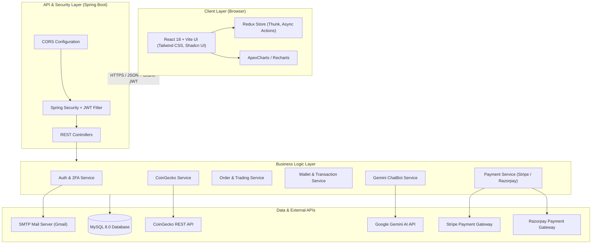

# 🪙 Crypto Trading Platform

[](https://spring.io/projects/spring-boot)
[](https://reactjs.org/)
[](https://vitejs.dev/)
[](https://tailwindcss.com/)
[](https://redux.js.org/)
[](https://www.mysql.com/)
[](https://openjdk.org/)
[](https://github.com/PriyanshuTarsauliya/Crypto-Trading-Platform/actions/workflows/main.yml)
[](https://opensource.org/licenses/MIT)

> A full-stack, enterprise-grade Cryptocurrency Trading and Portfolio Management Platform inspired by Binance and Coinbase. Built with a modern **Spring Boot 3** backend and a responsive **React 18 + Vite + Tailwind CSS** frontend, featuring **Google Gemini AI** intelligence, real-time market data via **CoinGecko**, dual payment gateways (**Stripe & Razorpay**), and multi-tier authentication with **Two-Factor Authentication (2FA)**.

---

## 📸 Screenshots & Showcase


---

## 📑 Table of Contents

- [Key Features](#-key-features)
- [System Architecture](#-system-architecture)
- [Tech Stack](#-tech-stack)
- [Project Structure](#-project-structure)
- [Getting Started](#-getting-started)
  - [Prerequisites](#prerequisites)
  - [Backend Setup (Spring Boot)](#1-backend-setup-spring-boot)
  - [Frontend Setup (React + Vite)](#2-frontend-setup-react--vite)
- [Configuration & Environment Variables](#-configuration--environment-variables)
- [API Overview](#-api-overview)
- [Database Schema Overview](#-database-schema-overview)
- [Security & 2FA Flow](#-security--2fa-flow)
- [Complete Technical Documentation](#-complete-technical-documentation)
- [Contributing](#-contributing)
- [License](#-license)

---

## 🌟 Key Features

### 🤖 1. Gemini AI-Powered Crypto Assistant
- **Real-Time Market Context**: Powered by Google Gemini API integrated directly with live CoinGecko pricing and market trends.
- **Smart Prompts & Inquiries**: Ask natural questions like *"Should I buy Bitcoin today?"*, *"Explain Ethereum gas fees"*, or *"Analyze Solana's 24h trend"*.
- **Autonomous Function Calling**: The backend parses crypto tickers and retrieves live metrics to enrich AI prompt context.

### 📈 2. Real-Time Trading Engine
- **Instant Buy & Sell**: Real-time order execution matching current market prices with wallet balance validation.
- **Interactive Price Charts**: High-performance interactive candlestick/line charts powered by **ApexCharts** and historical data intervals (1 day to 1 year).
- **Market Discovery**: Top 50 cryptocurrencies, 24-hour top gainers/losers, price change percentages, market cap rankings, and instant search.

### 💼 3. Comprehensive Portfolio & Asset Management
- **Asset Allocation**: Track current holdings, quantity owned, average purchase price, total valuation, and unrealized profit/loss.
- **Detailed Activity Logs**: Comprehensive record of all buy/sell orders, transaction timestamps, and order statuses.
- **Custom Watchlists**: Pin favorite cryptocurrencies for quick access and monitoring.

### 💳 4. Advanced Wallet & Banking System
- **Digital Fiat Wallet**: Built-in wallet with multi-currency balance support.
- **Dual Payment Gateway Top-ups**:
  - 🌐 **Stripe**: International card payments & checkout sessions.
  - 🇮🇳 **Razorpay**: UPI, NetBanking, Debit/Credit cards, and wallets.
- **Wallet-to-Wallet Transfers**: Seamlessly transfer funds to other platform users using their registered Wallet ID.
- **Bank Account Withdrawals**: Withdraw earnings directly to linked bank accounts with admin approval workflows.
- **Full Transaction Ledger**: Immutable tracking of deposits, transfers, purchases, sales, and withdrawals.

### 🔐 5. Bank-Grade Security & Authentication
- **Spring Security 6 + JWT**: Stateless, token-based authentication with expiration controls.
- **Two-Factor Authentication (2FA)**: Email-based OTP verification for sensitive operations and logins.
- **Role-Based Access Control (RBAC)**: Segregated permissions for standard traders (`ROLE_CUSTOMER`) and administrators (`ROLE_ADMIN`).
- **Password Recovery**: Secure password reset flow with time-bound OTP tokens sent via JavaMailSender.

---

## 🏗 System Architecture



---

## 🛠 Tech Stack

### Backend
| Technology | Description |
| :--- | :--- |
| **Java 17 / 19** | Core enterprise programming language |
| **Spring Boot 3.2.4** | Enterprise backend application framework |
| **Spring Security** | Robust authentication, RBAC, and web security |
| **Spring Data JPA / Hibernate** | Object-relational mapping (ORM) and persistence |
| **MySQL 8.0** | Relational database management system |
| **jjwt (JSON Web Tokens)** | Cryptographic stateless session tokens |
| **JavaMailSender** | Automated transactional emails and 2FA OTP delivery |
| **Stripe Java SDK (20.62.0)** | Global payment processing |
| **Razorpay Java SDK (1.4.3)** | Indian and multi-currency payment processing |
| **Lombok** | Boilerplate code reduction |

### Frontend
| Technology | Description |
| :--- | :--- |
| **React 18** | Declarative, component-based user interface |
| **Vite 5** | High-speed frontend build tool and dev server |
| **Redux + Redux Thunk** | Predictable global state management & async side effects |
| **Tailwind CSS 3.4** | Utility-first responsive styling framework |
| **Shadcn UI & Radix Primitives** | Accessible, headless, modern UI components |
| **ApexCharts & Recharts** | High-performance interactive market charting |
| **Lucide React** | Clean, modern iconography |
| **Axios** | HTTP client with automatic auth token interceptors |
| **React Router Dom 6** | Dynamic client-side routing |

---

## 📁 Project Structure

```plaintext
Crypto-Trading-Platform/
├── Backend/                                # Spring Boot 3 Backend
│   ├── src/
│   │   ├── main/
│   │   │   ├── java/com/zosh/
│   │   │   │   ├── config/                 # Security, JWT, App Configs
│   │   │   │   ├── controller/             # REST API Controllers (13 Controllers)
│   │   │   │   ├── domain/                 # Enums (OrderStatus, PaymentMethod, etc.)
│   │   │   │   ├── model/                  # JPA Entities (User, Order, Wallet, Coin, etc.)
│   │   │   │   ├── repository/             # Spring Data JPA Repositories
│   │   │   │   ├── request/                # DTO Request Payloads
│   │   │   │   ├── response/               # DTO API Responses
│   │   │   │   ├── service/                # Business Logic Interfaces & Implementations
│   │   │   │   └── utils/                  # OTP and Utility classes
│   │   │   └── resources/
│   │   │       └── application.properties  # Database, Mail, and API Key configs
│   │   └── test/                           # Unit and Integration tests
│   ├── mvnw / mvnw.cmd                     # Maven wrapper scripts
│   └── pom.xml                             # Maven project dependencies
│
├── Frontend/                               # React 18 + Vite Frontend
│   ├── public/                             # Static assets
│   ├── src/
│   │   ├── Admin/                          # Admin views (Withdrawals management)
│   │   ├── Api/                            # Axios API clients & endpoints
│   │   ├── components/                     # Reusable Shadcn UI & custom widgets
│   │   ├── pages/                          # Application routes & views
│   │   │   ├── Activity/                   # Order history and activity
│   │   │   ├── Auth/                       # Login, Register, 2FA, Password Reset
│   │   │   ├── Home/                       # Dashboard, Top 50, Gainers/Losers
│   │   │   ├── Navbar/ & SideBar/          # Navigation layouts
│   │   │   ├── Portfilio/                  # Assets, Holdings, Performance
│   │   │   ├── Profile/                    # User account & 2FA toggles
│   │   │   ├── Search/                     # Cryptocurrency search
│   │   │   ├── StockDetails/               # Real-time charts & Trading form
│   │   │   └── Wallet/                     # Balance, Deposit, Transfer, Withdraw
│   │   ├── Redux/                          # Redux slices (Auth, Coin, Wallet, Order, Chat)
│   │   ├── App.jsx                         # Root application component
│   │   └── main.jsx                        # React DOM mounting
│   ├── package.json                        # Node dependencies and scripts
│   ├── tailwind.config.js                  # Tailwind design system configuration
│   └── vite.config.js                      # Vite bundler configuration
│
├── DOCUMENTATION.md                        # Complete Technical & API Reference
└── README.md                               # Project presentation & quick start guide
```

---

## 🚀 Getting Started

### Prerequisites

Ensure you have the following installed on your machine:
- **Java Development Kit (JDK 17 or higher)** (`java -version`)
- **Node.js (v18 or higher)** & **npm** (`node -v`, `npm -v`)
- **MySQL Server (v8.0 or higher)** running on port `3306`
- **Git** (`git -version`)

---

### 1. Backend Setup (Spring Boot)

1. **Create the MySQL Database**:
   Open MySQL Workbench or your terminal:
   ```sql
   CREATE DATABASE treading;
   ```

2. **Configure Application Properties**:
   Open [`Backend/src/main/resources/application.properties`](file:///d:/Crypto-Trading-Platform-Using-Spring-boot-and-React-main/Crypto-Trading-Platform-Using-Spring-boot-and-React-main/Backend/src/main/resources/application.properties) and update the credentials:
   ```properties
   server.port=5454

   # MySQL Configuration
   spring.datasource.url=jdbc:mysql://localhost:3306/treading?useSSL=false&serverTimezone=UTC
   spring.datasource.username=root
   spring.datasource.password=YOUR_MYSQL_PASSWORD
   spring.jpa.hibernate.ddl-auto=update

   # SMTP Mail Configuration (For 2FA OTP and Password Reset)
   spring.mail.host=smtp.gmail.com
   spring.mail.port=587
   spring.mail.username=your-email@gmail.com
   spring.mail.password=your-gmail-app-password
   spring.mail.properties.mail.smtp.auth=true
   spring.mail.properties.mail.smtp.starttls.enable=true

   # Payment Gateways
   stripe.api.key=sk_test_YOUR_STRIPE_SECRET_KEY
   razorpay.api.key=rzp_test_YOUR_RAZORPAY_KEY
   razorpay.api.secret=YOUR_RAZORPAY_SECRET

   # External APIs
   coingecko.api.key=YOUR_COINGECKO_API_KEY
   gemini.api.key=YOUR_GEMINI_API_KEY
   ```

3. **Build and Run Backend**:
   Navigate to the Backend directory and start the server:
   ```bash
   cd Backend
   # On Windows:
   .\mvnw.cmd spring-boot:run
   # On macOS/Linux:
   ./mvnw spring-boot:run
   ```
   The backend API will start on **`http://localhost:5454`**.

---

### 2. Frontend Setup (React + Vite)

1. **Navigate to the Frontend directory**:
   ```bash
   cd Frontend
   ```

2. **Install Dependencies**:
   ```bash
   npm install
   ```

3. **Start Development Server**:
   ```bash
   npm run dev
   ```
   The frontend application will launch on **`http://localhost:5173`**.

---

## 🔑 Configuration & Environment Variables

| Parameter | Service | Purpose | Where to Get |
| :--- | :--- | :--- | :--- |
| `spring.datasource.*` | MySQL | Database connection | Local MySQL Installation |
| `spring.mail.*` | Gmail SMTP | Sending 2FA & Password OTPs | Google Account -> App Passwords |
| `stripe.api.key` | Stripe | Global credit card processing | [Stripe Dashboard](https://dashboard.stripe.com/) |
| `razorpay.api.*` | Razorpay | Indian UPI & card payments | [Razorpay Dashboard](https://dashboard.razorpay.com/) |
| `coingecko.api.key` | CoinGecko | Real-time crypto market data | [CoinGecko Developer API](https://www.coingecko.com/en/api) |
| `gemini.api.key` | Google AI | Powering AI Chatbot assistant | [Google AI Studio](https://aistudio.google.com/) |

---

## 📡 API Overview

The backend exposes a comprehensive set of RESTful endpoints:

| Domain | Method | Endpoint | Description | Auth Required |
| :--- | :---: | :--- | :--- | :---: |
| **Auth** | `POST` | `/auth/signup` | Register a new user | No |
| **Auth** | `POST` | `/auth/signin` | Sign in with email/password | No |
| **Auth** | `POST` | `/auth/two-factor/otp/{otp}` | Verify 2FA OTP and obtain JWT | No |
| **Coins** | `GET` | `/coins` | Get paginated list of coins | No |
| **Coins** | `GET` | `/coins/{coinId}/chart` | Historical price chart data | No |
| **Coins** | `GET` | `/coins/top50` | Top 50 cryptocurrencies | No |
| **Coins** | `GET` | `/coins/search?q={query}` | Search cryptocurrencies | No |
| **Trading**| `POST` | `/api/orders/pay` | Execute Buy or Sell order | Yes |
| **Trading**| `GET` | `/api/orders` | Get user order history | Yes |
| **Wallet** | `GET` | `/api/wallet` | Fetch current user wallet & balance | Yes |
| **Wallet** | `PUT` | `/api/wallet/{walletId}/transfer` | Transfer funds to another wallet | Yes |
| **Payment**| `POST` | `/api/payment/{method}/amount/{amt}` | Initialize Stripe/Razorpay payment | Yes |
| **AI Bot** | `POST` | `/chat/bot` | Query Gemini AI crypto chatbot | No |
| **Watchlist**| `PATCH` | `/api/watchlist/add/coin/{coinId}`| Toggle coin in watchlist | Yes |
| **Withdrawal**| `POST`| `/api/withdrawal/{amount}` | Request bank account withdrawal | Yes |
| **Admin**  | `PATCH`| `/api/admin/withdrawal/{id}/proceed/{status}` | Approve or reject withdrawal | Admin |

> 📖 **For complete API specifications with request/response schemas, see [DOCUMENTATION.md](file:///d:/Crypto-Trading-Platform-Using-Spring-boot-and-React-main/Crypto-Trading-Platform-Using-Spring-boot-and-React-main/DOCUMENTATION.md).**

---

## 🔒 Security & 2FA Flow

```
[User Login Request]
        │
        ▼
[Check Credentials & Password Match]
        │
        ├── If 2FA Disabled ─────────────► [Issue JWT Token Immediately]
        │
        └── If 2FA Enabled
                │
                ▼
        [Generate 6-digit Secure OTP]
                │
                ▼
        [Send OTP via Email (JavaMailSender)]
                │
                ▼
        [Client prompts for OTP input]
                │
                ▼
        [POST /auth/two-factor/otp/{otp}]
                │
                ▼
        [Verify OTP matches & not expired]
                │
                ▼
        [Issue JWT Bearer Token]
```

---

## 📚 Complete Technical Documentation

A full, detailed technical reference covering the complete internal architecture, database entity relationships, DTO specifications, and deployment recommendations is available in:
👉 **[DOCUMENTATION.md](file:///d:/Crypto-Trading-Platform-Using-Spring-boot-and-React-main/Crypto-Trading-Platform-Using-Spring-boot-and-React-main/DOCUMENTATION.md)**

---

## 🤝 Contributing

Contributions, issues, and feature requests are welcome!
1. Fork the Project
2. Create your Feature Branch (`git checkout -b feature/AmazingFeature`)
3. Commit your Changes (`git commit -m 'Add some AmazingFeature'`)
4. Push to the Branch (`git push origin feature/AmazingFeature`)
5. Open a Pull Request

---

## 📄 License

This project is open-source and licensed under the [MIT License](LICENSE).
